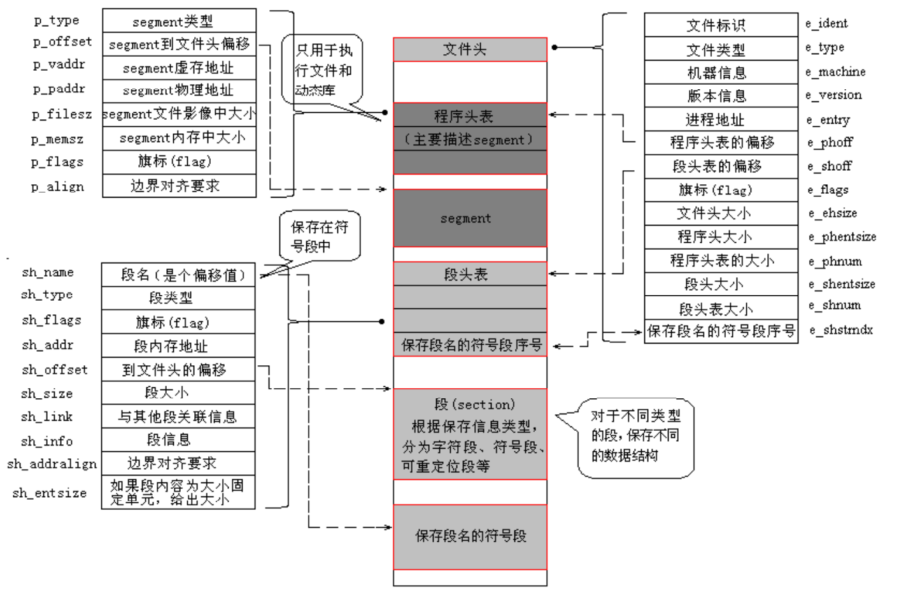

# Linux KMD初探——系统如何安装hello.ko的？

## 前言
前几天学习了Linux KMD的初步使用，但是对于内核模块如何被加载进内核，以及字符设备如何进一步和`/dev`节点、用户态文件接口关联起来，仍然有疑惑。因此，这几天基于Linux内核V5.16版本源码，深入学习一下内核模块。

本文聚焦模块加载过程。需要先说明：`insmod`本身不会在`/dev`下创建文件；它负责加载模块，字符驱动则通过设备号和`cdev`注册操作入口。二者如何连接到用户态`open()`将在后续字符设备文章中继续分析。

Linux内核源码可以直接在[bootlin](https://elixir.bootlin.com/)上找到，使用体验接近以前搞Android时使用的opengrok。由于内核代码规模庞大，因此不能像分析FreeRTOS那样面面俱到，看代码的原则是绝不节外生枝，只关心自己的问题！

## 从入口开始
### 入口
当我们执行 `insmod hello.ko` 时，内核其实调用了`finit_module`函数，其定义与实现如下:
```c
SYSCALL_DEFINE3(finit_module, int, fd, const char __user *, uargs, int, flags)
{
	struct load_info info = { };
	void *hdr = NULL;
	int err;

	err = may_init_module();
	if (err)
		return err;

	pr_debug("finit_module: fd=%d, uargs=%p, flags=%i\n", fd, uargs, flags);

	if (flags & ~(MODULE_INIT_IGNORE_MODVERSIONS
		      |MODULE_INIT_IGNORE_VERMAGIC))
		return -EINVAL;

	err = kernel_read_file_from_fd(fd, 0, &hdr, INT_MAX, NULL,
				       READING_MODULE);
	if (err < 0)
		return err;
	info.hdr = hdr;
	info.len = err;

	return load_module(&info, uargs, flags);
}
```
我们可以看到该函数读取了fd指向文件(hello.ko)的全部内容与长度到结构体变量`info`，随后直接跳入`load_module`。
继续往下看。我们直达核心处1`setup_load_info`.
```c
static int load_module(struct load_info *info, const char __user *uargs,
		       int flags)
{
	struct module *mod;
	long err = 0;
	char *after_dashes;

    /*跳过参数有效性检查：elf是否合法、模块签名是否合法，直达核心处1 */

	/*
	 * Everything checks out, so set up the section info
	 * in the info structure.
	 */
	err = setup_load_info(info, flags);
	if (err)
		goto free_copy;
    /*... ...*/
```
### setup_load_info
在`setup_load_info`中，第一步hello.ko的.modinfo段，拿到模块的名称，接下来遍历elf(hello.ko)中所有的section，找到.symtab(符号表)和.strtab(字符串表)。
符号表中每一项都代表程序中一个符号(函数、变量等)，字符串表记录的就是纯文本。
符号表每个表项大概如下:
```c
struct Elf64_Sym {
    uint32_t st_name;   // 名字在 .strtab 中的偏移
    uint8_t  st_info;   // 类型和绑定属性
    uint8_t  st_other;
    uint16_t st_shndx;  // 所属 section
    uint64_t st_value;  // 地址或节内偏移
    uint64_t st_size;   // 对象大小
};
```
而字符串表内容大概是：`\0hello_init\0init_module\0hello_exit\0cleanup_module\0_printk\0`。
这两个表配套起来就可以解析elf中所有的符号：
*找到所有的符号以及名称*
```c
	/* Find internal symbols and strings. */
	for (i = 1; i < info->hdr->e_shnum; i++) {
		if (info->sechdrs[i].sh_type == SHT_SYMTAB) {
			info->index.sym = i;
			info->index.str = info->sechdrs[i].sh_link;
			info->strtab = (char *)info->hdr
				+ info->sechdrs[info->index.str].sh_offset;
			break;
		}
	}
```

> 简单说一下elf文件格式
> 要想理解加载模块的过程，elf文件格式是绕不过的一道坎，因此简要介绍写elf文件格式，但是该内容不是这章主题，因此不多赘述，只说关键点，并且用到哪个说哪个。
> 
> 
> 
> 如图所示，elf文件(hello.ko)头部是文件头，我们可以用命令 `readelf -h hello.ko`  把文件头信息dump出来。
> 
> ELF头(文件头): 这是一个包含文件基本信息的头部，例如文件类型、架构、版本等。
> 
> 程序头表: 普通可执行ELF用program header描述segment，指导操作系统如何将文件映射到内存。
> 
> 节头表（section header table）: 这是一个包含section信息的数组，数组元素记录代码、数据等section的名称、类型、地址、偏移和大小。
>
> 需要注意，`hello.ko`是`ET_REL`可重定位目标文件，它的`e_phnum`为0。内核加载模块时主要使用section header table、section内容、符号表、字符串表和重定位表，而不是普通可执行文件的program header。
> 
> 代码section: 这是一个包含内核模块代码的section。
> 
> 数据section: 这是一个包含内核模块数据的section。
> 
> 符号表: 这是一个包含内核模块符号的表，例如函数名、变量名等。
> 
> 字符串表: 这是一个包含字符串的表，例如函数名、变量名等。
>
> 详细elf学习：[ELF Object File Format](https://gabi.xinuos.com/v42/elf.pdf)

接下来找到`.gnu.linkonce.this_module`段，并且将`info->mod`指向`.gnu.linkonce.this_module`所在elf中的偏移地址。
```c
	info->index.mod = find_sec(info, ".gnu.linkonce.this_module");
	if (!info->index.mod) {
		pr_warn("%s: No module found in object\n",
			info->name ?: "(missing .modinfo section or name field)");
		return -ENOEXEC;
	}
	/* This is temporary: point mod into copy of data. */
	info->mod = (void *)info->hdr + info->sechdrs[info->index.mod].sh_offset;
```
最后获取内核模块名称、定位`__versions` section的index，该函数就结束了。通过该函数，内核模块加载器获得了符号表所在section表中的index，以及其中符号关联的名称，`.gnu.linkonce.this_module`所在ELF中的偏移地址以及在section表中的index、模块名称和用于符号CRC校验的版本信息。
总结一下：
此时已经完成的是：

- [x] 找到模块名

- [x] 找到符号表

- [x] 找到字符串表

- [x] 找到 struct module 模板

- [x] 找到版本检查表

- [x] 找到 per-CPU section

尚未完成的是：

- [ ] 校验 vermagic

- [ ] 校验 license

- [ ] 检查模块依赖

- [ ] 分配最终模块内存

- [ ] 复制模块 section

- [ ] 解析外部符号

- [ ] 应用地址重定位

- [ ] 执行 hello_init


### rewrite_section_headers
接下来也是一个很关键的函数其实现如下：
```c
static int rewrite_section_headers(struct load_info *info, int flags)
{
	unsigned int i;

	/* This should always be true, but let's be sure. */
	info->sechdrs[0].sh_addr = 0;

	for (i = 1; i < info->hdr->e_shnum; i++) {
		Elf_Shdr *shdr = &info->sechdrs[i];

		/*
		 * Mark all sections sh_addr with their address in the
		 * temporary image.
		 */
		shdr->sh_addr = (size_t)info->hdr + shdr->sh_offset;

	}

	/* Track but don't keep modinfo and version sections. 
		.modinfo 和 __versions 清除了 SHF_ALLOC,layout_sections中不会规划它们的空间
	*/
	info->sechdrs[info->index.vers].sh_flags &= ~(unsigned long)SHF_ALLOC;
	info->sechdrs[info->index.info].sh_flags &= ~(unsigned long)SHF_ALLOC;

	return 0;
}

```
1. 该函数遍历每个section，然后把每个 section 的 sh_addr 改成它在临时内核缓冲区中的地址。
2. 清除了 .modinfo 和 __versions的 SHF_ALLOC 属性，使其不再参与最终模块内存分配。

由于hello.ko 是 ELF 可重定位文件，这种文件还没有固定的运行地址。因此，默认的sh_addr并不指向该文件拷贝到内存后section的实际地址，因此需要这一步将section的地址修改为内核临时缓冲区中的实际虚拟地址。

多讲一句：section的地址 sh_addr 会经历三个阶段：

- 第一阶段：磁盘中的 hello.ko：sh_addr 通常为 0； 数据位置 = info->hdr(.ko文件实际在磁盘的位置) + sh_offset
- 第二阶段：`rewrite_section_headers()` 之后，sh_addr = 临时 .ko 缓冲区地址(.ko文件已经被读到内存中了) + sh_offset
- 第三阶段：`move_module()` 之后，目前还没到这，后面再讲。

## layout_and_allocate
下面来到了insmod过程最关键的函数之一：`layout_and_allocate`,其作用是把临时读入内核的 ELF 数据，真正变成内核中“可执行、可长期管理”的模块对象。
```c
static struct module *layout_and_allocate(struct load_info *info, int flags)
{
	struct module *mod;
	unsigned int ndx;
	int err;
    /*校验vermagic、license、retpoline等模块兼容信息*/
	err = check_modinfo(info->mod, info, flags);
	if (err)
		return ERR_PTR(err);

    /*提供给不同指令集架构调整section的接口，本身是个弱引用，空实现。特定处理器上可以定义同名强引用函数实现它来调整section*/
	/* Allow arches to frob section contents and sizes.  */
	err = module_frob_arch_sections(info->hdr, info->sechdrs,
					info->secstrings, info->mod);
	if (err < 0)
		return ERR_PTR(err);

    /*可配置的section权限检查，不关键*/
	err = module_enforce_rwx_sections(info->hdr, info->sechdrs,
					  info->secstrings, info->mod);
	if (err < 0)
		return ERR_PTR(err);

	/* We will do a special allocation for per-cpu sections later. percpu的数据需要给每个核都复制一份，因此清除其属性，后面单独处理，我们的hello.ko中没有声明percpu变量，因此这步跳过*/
	info->sechdrs[info->index.pcpu].sh_flags &= ~(unsigned long)SHF_ALLOC;

	/*
	 * Mark ro_after_init section with SHF_RO_AFTER_INIT so that
	 * layout_sections() can put it in the right place.
	 * Note: ro_after_init sections also have SHF_{WRITE,ALLOC} set.
	 */
	ndx = find_sec(info, ".data..ro_after_init");
	if (ndx)
		info->sechdrs[ndx].sh_flags |= SHF_RO_AFTER_INIT;
	/*
	 * Mark the __jump_table section as ro_after_init as well: these data
	 * structures are never modified, with the exception of entries that
	 * refer to code in the __init section, which are annotated as such
	 * at module load time.
	 */
	ndx = find_sec(info, "__jump_table");
	if (ndx)
		info->sechdrs[ndx].sh_flags |= SHF_RO_AFTER_INIT;

	/*
	 * Determine total sizes, and put offsets in sh_entsize.  For now
	 * this is done generically; there doesn't appear to be any
	 * special cases for the architectures.
	 */
	layout_sections(info->mod, info);
	layout_symtab(info->mod, info);

	/* Allocate and move to the final place */
	err = move_module(info->mod, info);
	if (err)
		return ERR_PTR(err);

	/* Module has been copied to its final place now: return it. */
	mod = (void *)info->sechdrs[info->index.mod].sh_addr;
	kmemleak_load_module(mod, info);
	return mod;
}
```


略提的部分已在上述代码注释中标出，下面我们直达核心:计算模块内存布局`layout_sections`。

### layout_sections
该函数的第一个输入参数就是info->mod, 它是作为最终模块在运行内存时状态(上述的第三阶段)的临时工作副本。它既用来做内存规划，也保存模块运行所需的核心描述信息；规划完成后，这份内容会被复制到最终模块内存。
mod结构体大概包含如下内容:

```c
mod->name  //name 是 "hello"
mod->init //指向模块初始化入口
mod->exit //指向模块卸载入口
mod->core_layout
mod->init_layout
...
```

先看对各个段进行的五种分类:
```c
static unsigned long const masks[][2] = {
    { SHF_EXECINSTR | SHF_ALLOC, ARCH_SHF_SMALL },
    { SHF_ALLOC, SHF_WRITE | ARCH_SHF_SMALL },
    { SHF_RO_AFTER_INIT | SHF_ALLOC, ARCH_SHF_SMALL },
    { SHF_WRITE | SHF_ALLOC, ARCH_SHF_SMALL },
    { ARCH_SHF_SMALL | SHF_ALLOC, 0 }
};
```
该数组的每一行表示一种段的类型.
每个分类的第0列 masks[m][0] 表示某个段必须有的一种标志, 第1列 masks[m][1] 表示如果属于该类型的段,则不能具备该标志,否则会被判断为非法,不做处理.
类型如下
| 顺序 | 类型 | 判断条件 |
|---|---|---|
| 0 | 可执行代码 | 必须 `ALLOC + EXEC` |
| 1 | 只读数据 | 必须 `ALLOC`，不能 `WRITE` |
| 2 | 初始化后只读 | 必须 `ALLOC + RO_AFTER_INIT` |
| 3 | 可写数据 | 必须 `ALLOC + WRITE` |
| 4 | 架构的小数据/catch-all | 架构相关 |

接下来为属于core_layout的各个section规划空间:
```c
for (m = 0; m < ARRAY_SIZE(masks); ++m) {
		for (i = 0; i < info->hdr->e_shnum; ++i) {
			Elf_Shdr *s = &info->sechdrs[i];
			const char *sname = info->secstrings + s->sh_name;

				/*
				如果不具备必须的标志     -> 跳过
				如果带有禁止的标志       -> 跳过
				如果已经安排过位置       -> 跳过
				如果属于 init section   -> 在 core 阶段跳过
				*/
			if ((s->sh_flags & masks[m][0]) != masks[m][0]
			    || (s->sh_flags & masks[m][1])
			    || s->sh_entsize != ~0UL
			    || module_init_layout_section(sname))
				continue;
			/*计算当前section在core_layout中的偏移,并临时用s->sh_entsize保存*/
			s->sh_entsize = get_offset(mod, &mod->core_layout.size, s, i);
			pr_debug("\t%s\n", sname);
		}
		switch (m) {
		case 0: /* executable */
			mod->core_layout.size = debug_align(mod->core_layout.size);
			mod->core_layout.text_size = mod->core_layout.size;
			break;
		case 1: /* RO: text and ro-data */
			mod->core_layout.size = debug_align(mod->core_layout.size);
			mod->core_layout.ro_size = mod->core_layout.size;
			break;
		case 2: /* RO after init */
			mod->core_layout.size = debug_align(mod->core_layout.size);
			mod->core_layout.ro_after_init_size = mod->core_layout.size;
			break;
		case 4: /* whole core */
			mod->core_layout.size = debug_align(mod->core_layout.size);
			break;
		}
	}
```
接下来,再用同样的方式处理 init_layout,只有名称符合 `.init.*`才属于 init_layout.
有一个小注意事项: init_layout 中各个段的偏移地址会用掩码与 core_layout 区分:
```c
s->sh_entsize = (get_offset(mod, &mod->init_layout.size, s, i)| INIT_OFFSET_MASK);
```
后续的`move_module`会根据`INIT_OFFSET_MASK`掩码区分core与init.

如果编译时使用了宏`CONFIG_KALLSYMS`,还会执行`layout_symtab(info->mod, info)`规划完整的字符串表和符号表,便于后续对模块的调试.

`layout_sections`结束后, info->mod 中各个段的相对偏移地址与大小就已经都具备了, 接下来就是调用`move_module(info->mod, info)` 进行地址分配以及搬家.

### move_module
这块的逻辑比较简单,其主要作用:
1. 按照mod的size信息分配core 与 init 的空间: ptr;
2. 按照mod与ptr计算属于core与init的各个section的实际运行地址:ptr + shdr->sh_entsize(基址 + 偏移)
3. 搬家,将section从.ko文件在内存的临时缓冲区中搬到实际运行地址, 之后 section就到了上述*第三阶段*的状态.
```c
static int move_module(struct module *mod, struct load_info *info)
{
	int i;
	void *ptr;

	/* Do the allocs. */
	ptr = module_alloc(mod->core_layout.size);

	... ...

	memset(ptr, 0, mod->core_layout.size);
	mod->core_layout.base = ptr;

	if (mod->init_layout.size) {
		ptr = module_alloc(mod->init_layout.size);
		... ...
		memset(ptr, 0, mod->init_layout.size);
		mod->init_layout.base = ptr;
	} else
		mod->init_layout.base = NULL;

	for (i = 0; i < info->hdr->e_shnum; i++) {
		void *dest;
		Elf_Shdr *shdr = &info->sechdrs[i];

		if (!(shdr->sh_flags & SHF_ALLOC))
			continue;

		if (shdr->sh_entsize & INIT_OFFSET_MASK)
			dest = mod->init_layout.base
				+ (shdr->sh_entsize & ~INIT_OFFSET_MASK);
		else
			dest = mod->core_layout.base + shdr->sh_entsize;

		if (shdr->sh_type != SHT_NOBITS)
			memcpy(dest, (void *)shdr->sh_addr, shdr->sh_size);
		/* Update sh_addr to point to copy in image. */
		shdr->sh_addr = (unsigned long)dest;
		... ...
	}

	return 0;
}
```
## 接下来呢?
这时候模块的主要section已经进入运行内存了,mod也指向最终模块运行内存,但是就可以直接运行了吗? 别忘了, 我们在模块中调用了`kmalloc` `kfree`等等内核提供的函数,这些函数的地址还没有确定呢.
接下来insmod会把模块会
1. 把模块信息登记到内核:`add_unformed_module(mod)`,避免模块重复加载,或加载同名模块;
2. 定位并记录一些可选的section信息到mod中;
3. 把模块链接到最终内核,首先解析符号表 `simplify_symbols`:
   1. simplify_symbols() 会遍历符号表,把每个属性为SHN_UNDEF的符号都去到当前内核的导出符号表中查找是否存在;
   2. 检查 GPL 限制与namespace;
   3. 比较 __versions 中的 CRC;
   4. 取得符号在当前内核中的真实地址;
   5. 写入模块符号表
4. 符号表解析完还不够，模块机器指令和数据结构中的占位地址也必须改写:例如
5. 调用`apply_relocations`，按ELF重定位表修改模块中的机器指令和数据结构：
   - `.gnu.linkonce.this_module`中的`R_X86_64_64`重定位会把`init_module`和`cleanup_module`的最终地址写入`mod->init`和`mod->exit`；
   - 对`_printk`等函数的调用通常使用`R_X86_64_PLT32`重定位，写入的是`S + A - P`计算出的PC相对位移，而不是把整条`call`指令改成绝对地址；
   - 如果数据结构中保存了函数指针，对应的数据section重定位会把目标函数的最终地址写入指针字段。字符驱动中的`file_operations`表就是这种用法。
6. 通过`mod_sysfs_setup`建立模块的sysfs目录: /sys/module/hello/
7. 释放第二阶段的.ko文件缓冲区
8. 最后进入`do_init_module`，通过`do_one_initcall(mod->init)`执行模块初始化入口

此时insmod的主要加载流程就完成了。core layout中的section会长期驻留在内存中，直到模块被卸载；`.init.text`、`.init.data`等init layout会在初始化成功后释放，而加载时使用的`.modinfo`和`__versions`已经提前清除了`SHF_ALLOC`，不会长期驻留。


## 回首复习
整个过程太长了，再通过hello_init如何成为模块加载器实际调用的初始化入口来复习一下。
1. 首先,构建后,hello_init就会被导出为一个别名:init_module,属于 .init.text section
2. load_module读入了整个.ko文件的字节流到内存,
3. setup_load_info 找到所有的符号以及其名称所在的位置
4. 找到内存中info->mod的位置,它就是我们模块在内存中的"设计图",会根据"设计图"将模块搬家到运行地址
5. layout_sections规划设计图，move_module按设计图分配并复制core与init内存。此时`mod->init_layout.base`指向整个init内存块，`.init.text`位于其中的某个偏移；`mod->init`仍然要等待后续重定位。
6. simplify_symbols解析模块内部符号和外部内核符号，得到init_module以及_printk等符号的最终地址。
7. apply_relocations处理`.rela.gnu.linkonce.this_module`中的重定位项，把init_module的最终地址写入`mod->init`。
8. do_init_module通过`do_one_initcall(mod->init)`调用init_module，而init_module与hello_init地址相同，因此最终执行hello_init。
9. hello_init成功返回后，模块状态变为LIVE，core layout继续驻留，init layout随后被释放；如果返回错误，则模块进入卸载流程并释放已经分配的资源。


