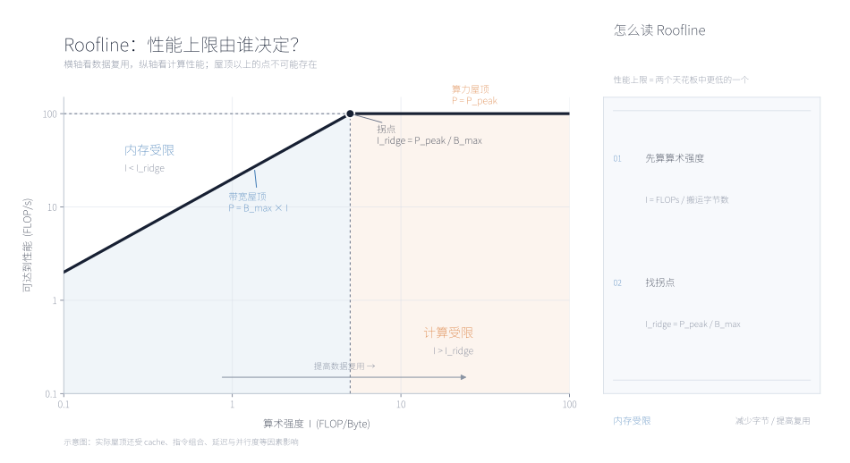
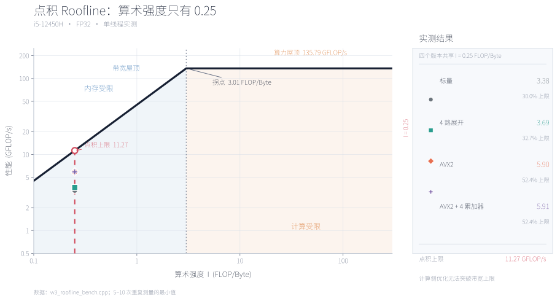

## Roofline简介
Roofline 模型是一种用于分析硬件计算性能瓶颈的工具，通过可视化计算性能与算术强度（计算量 / 数据搬运量）的关系，判断系统受限于计算能力还是内存带宽。
为了做性能分析，Roofline 模型论文引入了“操作强度”（operational intensity）这个概念，表示每字节 DRAM 数据传输（traffic）所对应的操作次数（每字节 flops），这里的字节数是指那些经过缓存层过滤后进入主内存 DRAM 的字节，即我们关注的是处理器与内存之间的数据传输，而不是处理器与缓存之间的数据传输（traffic）。
算术强度公式定义如下：
OI = 总浮点操作数（FLOPs） / 总内存访问量（Bytes）



上图展示了 Roofline 模型的基本思路：**一个程序能达到的性能，通常受两个“天花板”共同限制**，分别是硬件的计算峰值和内存带宽能够支撑的计算速度。

### 横轴：算术强度

横轴表示算法的**算术强度**（Operational Intensity，OI），定义为每搬运一个字节的数据，能够完成多少次浮点运算：

```text
OI = 总浮点操作数（FLOPs） / 总内存访问量（Bytes）
```
### 两条屋顶
**带宽屋顶** 是图中前半部分的斜线，它说明当程序受内存供给限制时，性能会随着算术强度的增加而线性上升。
```
P_memory(计算性能) = OI(算术强度) × B_max(内存带宽)
```
**算力屋顶**是图中后半部分的水平线：P_peak，表示硬件的峰值计算能力。无论算术强度继续增加多少，性能最终都不能超过这个上限。

把两个**屋顶**放到一起，就得到了Roofline模型：
```
P_max = min(P_peak, OI × B_max)
```
两条屋顶相交的点称为拐点，表示计算能力和内存带宽刚好同时被充分利用的位置。

```
OI_ridge = P_peak / B_max
```
下面会通过一个点积计算的实验来说明roofline模型。


## 标量与SIMD点积实现

点积计算本身很简单：把两个数组中对应位置的元素相乘，再把所有乘积累加。为了保证不同优化版本的结果便于比较，四种实现使用同一组输入，并且都处理数组长度不是向量宽度整数倍时的尾部元素。

下面的核心代码来自 ARM NEON 版本的 `w3_dot4_lab.c`。为了让重点保持在计算结构上，这里省略了头文件、测试框架和程序入口，只保留四种实现的核心循环。

### 版本 1：标量实现

标量版本使用一个累加器，每次处理一个元素：

```c
float dot_scalar(const float* a, const float* b, int n)
{
    float s = 0.0f;
    for (int i = 0; i < n; ++i) {
        s += a[i] * b[i];
    }
    return s;
}
```

它的优点是直观，缺点是循环中的每次加法都依赖上一次的结果，因此形成一条串行依赖链。

### 版本 2：标量 4 路展开

四路展开同时维护四个标量累加器，每一轮计算四个乘积：

```c
float dot_unrolled(const float* a, const float* b, int n)
{
    float s0 = 0, s1 = 0, s2 = 0, s3 = 0;
    int i = 0;
    for (; i + 4 <= n; i += 4) {
        s0 += a[i + 0] * b[i + 0];
        s1 += a[i + 1] * b[i + 1];
        s2 += a[i + 2] * b[i + 2];
        s3 += a[i + 3] * b[i + 3];
    }
    float sum = s0 + s1 + s2 + s3;
    for (; i < n; ++i) {
        sum += a[i] * b[i];
    }
    return sum;
}
```

四个累加器彼此独立，可以让多条加法流水线交替执行。不过这种展开仍然是一条标量指令处理一个元素，并没有减少需要搬运的字节数。

### 版本 3：NEON 单累加器

NEON 版本一次加载四个 `float`，用 `vfmaq_f32` 完成向量乘加，最后通过 `vaddvq_f32` 做横向归约：

```c
float dot_neon(const float* a, const float* b, int n)
{
    float32x4_t acc = vdupq_n_f32(0.0f);
    int i = 0;
    for (; i + 4 <= n; i += 4) {
        float32x4_t q0 = vld1q_f32(a + i);
        float32x4_t q1 = vld1q_f32(b + i);
        acc = vfmaq_f32(acc, q0, q1);
    }
    float sum = vaddvq_f32(acc);
    for (; i < n; ++i) {
        sum += a[i] * b[i];
    }
    return sum;
}
```

一次向量乘加覆盖四个元素，因此相同的计算量对应更少的指令，访存请求也能发送得更密集。不过 `acc` 仍然被连续迭代复用，连续两次 `vfmaq_f32` 之间存在依赖。

### 版本 4：NEON + 4 个累加器

为了打破向量累加器之间的依赖，这一版使用四个独立累加器，每轮处理 16 个元素：

```c
float dot_neon4(const float* a, const float* b, int n)
{
    float32x4_t acc0 = vdupq_n_f32(0.0f);
    float32x4_t acc1 = vdupq_n_f32(0.0f);
    float32x4_t acc2 = vdupq_n_f32(0.0f);
    float32x4_t acc3 = vdupq_n_f32(0.0f);
    int i = 0;

    for (; i + 16 <= n; i += 16) {
        acc0 = vfmaq_f32(acc0, vld1q_f32(a + i + 0),  vld1q_f32(b + i + 0));
        acc1 = vfmaq_f32(acc1, vld1q_f32(a + i + 4),  vld1q_f32(b + i + 4));
        acc2 = vfmaq_f32(acc2, vld1q_f32(a + i + 8),  vld1q_f32(b + i + 8));
        acc3 = vfmaq_f32(acc3, vld1q_f32(a + i + 12), vld1q_f32(b + i + 12));
    }

    for (; i + 4 <= n; i += 4) {
        acc0 = vfmaq_f32(acc0, vld1q_f32(a + i), vld1q_f32(b + i));
    }

    float32x4_t acc = vaddq_f32(
        vaddq_f32(acc0, acc1),
        vaddq_f32(acc2, acc3)
    );
    float sum = vaddvq_f32(acc);

    for (; i < n; ++i) {
        sum += a[i] * b[i];
    }
    return sum;
}
```

这一版把一条长依赖链拆成四条较短的依赖链，让处理器能够交错执行更多的 FMA 指令。它改善的是计算流水线利用率，并没有改变算法需要读取的数组大小。

### 正确性实验数据

实验使用 `N = 1000`，输入数组按下面的规则生成：

```c
for (int i = 0; i < N; ++i) {
    a[i] = (float)(i % 17) * 0.1f;
    b[i] = (float)(i % 13) * 0.2f;
}
```


## 点积算术强度推导

对两个 FP32 数组做点积时，每个元素需要读取 `a[i]` 和 `b[i]`，共 8 字节；同时完成一次乘法和一次加法，共 2 FLOPs。因此：

```text
OI = 2 FLOPs / 8 Bytes = 0.25 FLOP/Byte
```

无论使用标量、循环展开还是 SIMD，点积的总计算量和总数据量都没有变化，所以四种实现的算术强度都约为 `0.25 FLOP/Byte`。优化改变的是指令组织方式和硬件利用率，而不是 Roofline 图上的横坐标。

本机的相关测试数据如下：

| 参数 | 测量值 |
|---|---:|
| 内存带宽 `B_max` | 45.09 GB/s |
| 峰值浮点算力 `P_peak` | 135.79 GFLOP/s |
| 拐点 `P_peak / B_max` | 3.01 FLOP/Byte |
| 点积机器上限 `0.25 × 45.09` | 11.27 GFLOP/s |

点积的算术强度 `0.25` 远小于拐点 `3.01`，所以在 Roofline 图上，它始终落在左侧的内存受限区域。

随后的性能数据来自同一组优化思路在 x86 AVX2 版本上的计时实验。代码部分使用 NEON 是为了展示核心结构，性能表则对应本机的 AVX2 实现。

| 版本 | 实测性能 | 占机器上限 |
|---|---:|---:|
| 标量 | 3.382 GFLOP/s | 30.0% |
| 标量 4 路展开 | 3.689 GFLOP/s | 32.7% |
| AVX2 单累加器 | 5.904 GFLOP/s | 52.4% |
| AVX2 + 4 累加器 | 5.910 GFLOP/s | 52.4% |




## SIMD不减少操作字节数

SIMD 容易让人产生一个误解：既然一次能算多个元素，是不是也减少了内存访问量？答案是否定的。

| | 标量处理 8 个 float | AVX2 处理 8 个 float |
|---|---:|---:|
| 读取 `a` | 32 字节 | 32 字节 |
| 读取 `b` | 32 字节 | 32 字节 |
| 总搬运量 | 64 字节 | 64 字节 |
| 主循环中的加载操作 | 8 次 | 2 次 |
| 乘加指令 | 8 次乘、8 次加 | 1 条向量 FMA |

AVX2 一次加载 8 个 `float`，但读取的总字节数完全相同。它减少的是指令数量，并让内存请求发送得更密集，从而提高了能够达到的内存级并行度（Memory-Level Parallelism，MLP）。

即字节总量没有变化，单位时间内搬运并参与计算的数据量却提高了。

## 提高上限 vs 逼近上限

Roofline 分析中需要区分两个不同问题：

- **抬高上限**：改变算法、数据表示或硬件，让屋顶变高，或者让算法点向右移动(减少内存访问(提高cache命中率))；
- **逼近上限**：算法和算术强度不变，通过更好的指令、并行度和访存组织接近当前屋顶。

对于单次 FP32 点积，四个版本的数据复用都没有变化，因此它们只能逼近已有的理论上限：

| 手段 | 对 Roofline 的影响 |
|---|---|
| 标量 4 路展开 | 不改变 `OI`，缩短计算依赖链 |
| SIMD | 不改变搬运字节数，提高指令吞吐和达成带宽 |
| SIMD + 多累加器 | 不改变 `OI`，进一步增加指令级并行 |
| 多线程 | 不改变算法 `OI`，但提高可达到的聚合带宽 |
| FP16 量化 | 字节数减半，`OI` 从 0.25 提高到约 0.5 |
| 批量计算并复用数据 | 提高数据复用率，使点向右移动 |

点积中每个输入元素通常只参与一次乘加，没有类似矩阵乘法那样丰富的数据复用。因此，单纯给单次点积分块并不会提高算术强度。如果希望真正抬高点积的屋顶，需要一次处理多个共享同一组数据的点积，或者通过量化减少每个元素的字节数。

## 结论

Roofline 给出的不是某个实现“写得好不好”的结论，而是“这个算法在这块硬件上的性能天花板在哪里”。四种实现共享相同的算术强度 `0.25 FLOP/Byte`，所以它们优化的是如何更有效地利用内存带宽，而不是如何把点积搬到计算受限区域。

实验中最值得注意的现象是：SIMD 和循环展开带来了性能提升，但继续增加向量累加器后几乎不再变化；真正把性能推向机器上限的是多线程带来的聚合带宽。这与 Roofline 的预测一致——**先判断程序受限于带宽还是算力，再选择优化方向**。
